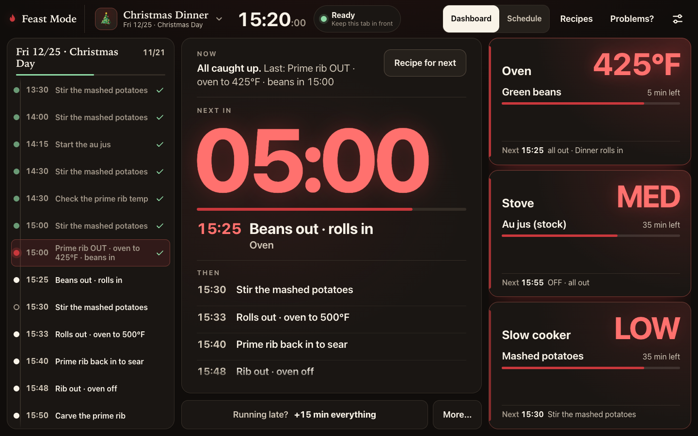
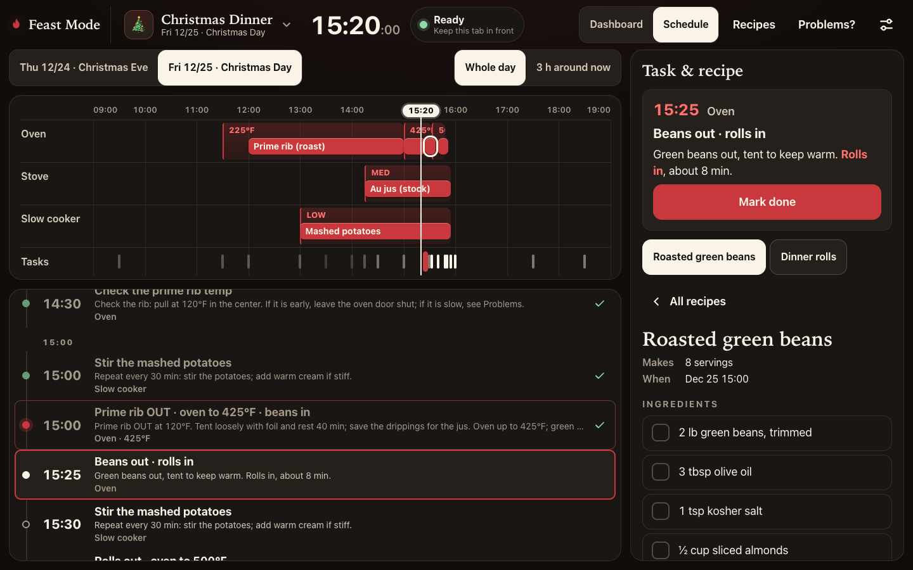
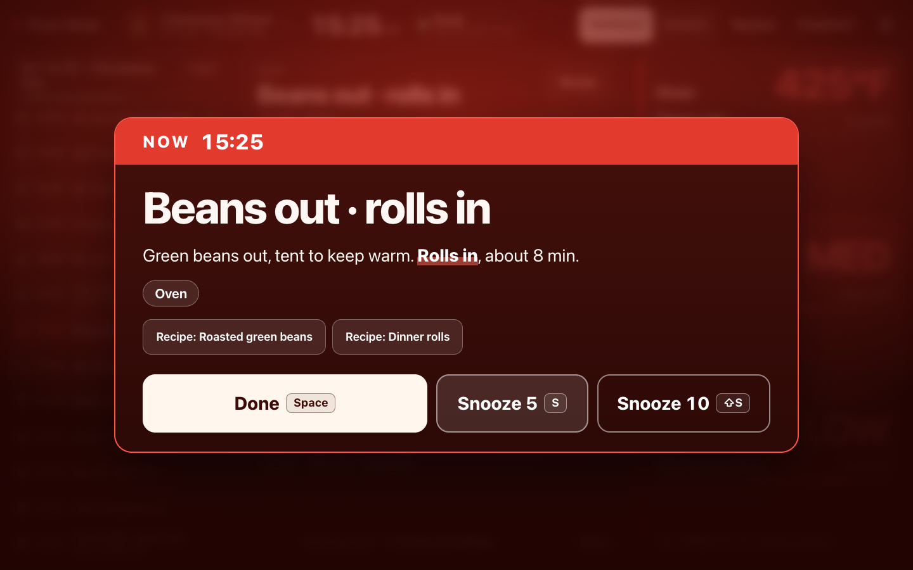

# Feast Mode

**Keep track of the big cook.**

Feast Mode is a cook-along for busy home chefs making a big holiday meal (Thanksgiving, Christmas, Easter, Passover, Friendsgiving, and more) on a laptop on the kitchen counter. It tells you what to do next, when to move each dish in and out of the oven, smoker, grill or slow cooker, and keeps the recipes one glance away.



It runs locally in Chrome or Brave. No account, no backend, no hosting. Your plans and progress stay in your browser.

## Quick start: make your own plan

1. Install and start the app:

   ```bash
   npm install
   ```

   ```bash
   npm start
   ```

   This opens http://localhost:5173 in your browser.

2. In the app, open **Plans** and press **Copy AI prompt**. You can also open [docs/MENU_PROMPT.md](docs/MENU_PROMPT.md) directly.
3. Paste the prompt into ChatGPT, Claude or any AI chat. Fill in the **MY EVENT** block (date, serving time, guests, equipment, menu) and send it.
4. Copy the JSON the AI returns. In **Plans**, paste it or upload the `.json` file, then press **Import**. Any errors or warnings list the exact field to fix. You can paste them back to the AI and ask for a corrected plan.
5. Rehearse the day: **Settings → Test mode**, pick a quick jump, set the speed to 60×, keep **Fresh rehearsal** on, then press **Start test mode**.
6. On the day, press **Start my day** (see [On the day](#on-the-day)).

Optional check from the command line:

```bash
npm run check-plan -- my-plan.json
```

To ship a plan with the app, put it in `plans/` and add it in `src/data/plan.ts`.

## Features

- **Full-screen alarms** that loop until you press **Done**, **Snooze 5** or **Snooze 10**. Heads-up alerts come 5 minutes before every oven move. Desktop notifications back up the alarms.
- **Dashboard** with a big countdown to the next step, an equipment board showing what is in each device and at what temperature, and today's timeline.
- **Schedule** with a whole-day equipment timeline, every step, and recipes docked on the side with checkboxes.
- **Running late?** Push everything back +15 minutes, or one device at a time (+5, +10, +15, +30).
- **Problems?** panel with fallback plans and probe temperatures.
- **Test mode** to rehearse the whole day at 60× (or 120×). It turns itself off before the real day starts.
- **Text size and light/dark** options.
- **Progress survives a reload.**

| Schedule with recipes on the side | An alert you can't miss |
|---|---|
|  |  |

## Keyboard

| Key | Action |
|---|---|
| Space | Done (or "Got it" on a heads-up) |
| S | Snooze 5 minutes |
| Shift+S | Snooze 10 minutes |
| F | Fullscreen |
| Esc | Close panel |

## On the day

- Plug in the laptop and set sleep to **Never** while plugged in.
- Turn the volume up.
- Press **Start my day**. This unlocks sound, asks for notification permission and keeps the screen awake. Press it again after every reload.
- Allow notifications.
- Keep the tab in front. Background tabs get throttled, but missed alerts appear right away, stacked, when you come back.
- Add `localhost` to Chrome's Memory Saver list under **Always keep these sites active**.
- Press **F** for fullscreen.

## Bundled example plans

- **Thanksgiving 2026**: two days, five devices (oven, Traeger, propane grill, slow cooker, stove), 11 recipes.
- **Christmas Dinner**: prime rib with a reverse sear, America/Chicago time zone.

Load either one from **Plans**.

## Other commands

```bash
npm run dev
```

Dev server with hot reload.

```bash
npm run build:single
```

Writes `dist-single/index.html`, which opens straight from disk in a pinch. Desktop notifications and the wake lock may not work from `file://`, so use localhost when you can.

```bash
npm test
```

Runs 240+ Vitest tests, including a 60× simulation of a full day.

```bash
npm run e2e
```

Runs Playwright tests in your installed Chrome. A full run takes about 8.5 minutes. To go faster:

```bash
E2E_SPEED=300 npm run e2e
```

## Privacy

Plans, progress and settings are stored in your browser's localStorage. Nothing is sent anywhere.

## Food safety

Probe temperatures in plans are guidance only. Go by your thermometer and trusted food-safety sources.

## Documentation

- [docs/MENU_PROMPT.md](docs/MENU_PROMPT.md): the AI prompt for writing a plan
- [docs/PLAN_FORMAT.md](docs/PLAN_FORMAT.md): the plan JSON format
- [docs/ARCHITECTURE.md](docs/ARCHITECTURE.md): how the code is organized

## Project layout

- `plans/`: JSON plans and `plan.schema.json`
- `src/data/`: plan format types, validator and loader
- `src/engine/`: pure scheduling logic (time, alerts, equipment board, shifts, storage)
- `src/app/`: state hooks
- `src/audio/`: Web Audio alarms
- `src/platform/`: notifications, wake lock, worker ticker
- `src/ui/`: React components
- `scripts/check-plan.ts`: command-line plan checker
- `e2e/`: Playwright tests
- `docs/`: prompt, format and architecture docs

## Contributing

See [CONTRIBUTING.md](CONTRIBUTING.md).

## License

MIT. See [LICENSE](LICENSE).

Built with Claude Code.
